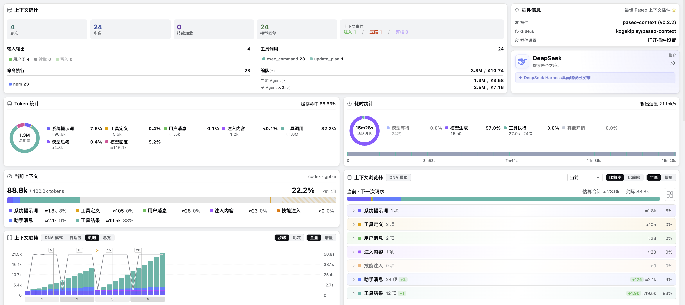
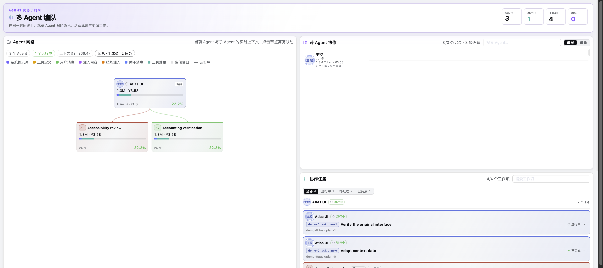

# Paseo Context

[English](README_en.md)

Paseo 的上下文洞察插件。基于 [bowenliang123/dsh-context](https://github.com/bowenliang123/dsh-context) 的公开 fork，直接复用上游当前版本的 React 界面、CSS、图表、浏览器和八种语言翻译，以 Paseo 的会话数据替换原宿主数据源。

保留原版多色配色及原版明暗样式，不将图表改成 Paseo 的主题色。界面源代码来自上游，而不是根据旧截图重画。

以下为插件实际运行截图，使用仓库内生成的示例数据：




## 安装

需要 Paseo **0.15.4 或更新版本**，以及可运行 Node.js 22+ 的 daemon。完整交互界面直接运行于 Desktop、网页及 iOS/iPadOS 原生客户端；手机和平板使用上游响应式布局。原生端复用 Paseo 内置 WebView，iPad 客户端已完成真实运行握手。Android 提供独立消息桥，目前属于实验性支持。

在 Paseo 启用插件后安装：

```sh
paseo plugin install git:kogekiplay/paseo-context
```

也可在 Settings → Plugins 中输入 `git:kogekiplay/paseo-context`。安装时会从源码构建原版界面。插件运行于所选 daemon，远程连接时读取远程 daemon 的会话记录。

从源码开发：

```sh
git clone https://github.com/kogekiplay/paseo-context.git
cd paseo-context
npm ci --ignore-scripts
npm run build
paseo plugin install "$PWD"
```

修改后执行 `npm run build` 和 `paseo plugin reload paseo-context`。

## 界面与入口

- **上下文标签页和 Explorer 侧栏**：上下文组成、实际使用量、Token 分类、耗时、趋势、逐步/逐轮切换、全量/增量及前一步/前一轮对比。
- **上下文浏览器**：原版 DNA、分组列表、矩形树图、消息和工具筛选、内容展开、系统提示词与工具定义查看。
- **文件活动、命令执行**：读取/写入/搜索、行数和次数、失败命令、执行耗时及后台进程状态。
- **编队**：Agent 网络、跨 Agent 通信时间线、委派、捕获到的任务与依赖、提示词和回复详情。
- **上下文洞察**：跨会话用量、日期范围、热力图、技能/工具/程序排行、搜索、归档和目录筛选。
- **标签页入口和命令**：composer 的“上下文”按钮、`/context` 和 Command Center 的“上下文”直接打开当前 Agent 对应的工作区标签页。`/context fleet` 打开编队标签页，`/context insights` 打开跨会话洞察，`/context modal` 保留弹窗。
- **偏好设置**：面板位置、编队开关、洞察入口、默认范围、图表粒度、增量基线、排序和趋势设置。

桌面也可点工作区标签栏的“+”添加“上下文”或“编队”。这些是 Paseo 原生工作区标签页，与 Agent、终端和文件并列，仍绑定打开时的 Agent；Paseo 当前没有 DSH 那种会话内部固定子标签的插件接口。面板位置设为“仅侧栏”时，上下文入口打开 Explorer；隐藏面板后，显式命令使用独立页面。

原版设置中的提示词前缀/后缀映射为 Paseo **新建 Agent 的 systemPrompt**。修改设置不会重写已有 Agent 的提示词；Paseo 当前没有与上游逐请求动态系统提示词章节完全等价的插件接口。

## 数据来源与统计口径

优先读取 daemon 本地的 **Codex rollout JSONL** 和 **Claude Code 会话 JSONL**，包括完整已落盘历史、压缩后的替代历史、回滚和工具结果。其他 provider 或无法找到原始日志的会话，使用 Paseo timeline 分页回退。

“实际”表示供应商已报告的用量；彩色组成是对可观测文本的估算，使用上游的固定密度算法。日志未记录的系统提示词、工具 schema、加密思考、服务端注入和不可观测阶段无法还原，空值不代表这些内容没有消耗 tokens。回退 timeline 的用量和内部上下文尤其有限。

费用按公开模型价目估算；未知模型保持未计价。时间表示可观测的请求/工具区间；并行工具的总工作耗时与实际忙碌时长分别计算。输出速度基于具有可用耗时的输出样本。它们不是账户账单或供应商完整服务端追踪。

Paseo 原生子 Agent 关系及日志中的子会话会映射到编队。任务、收件人、状态和依赖以日志实际捕获的字段为准。未公开的 Agent 团队内部状态无法凭空补齐。

原宿主的账号钱包、资源协议、文件管理器和会话内置页面没有保留兼容层。文件操作改用 Paseo Context 自己的预览，复用上游富文本查看器；支持当前文件的文本（前 2 MiB）和图片（20 MiB 内）预览。日志内保留的图片可直接查看；缺失的附件与不支持的二进制格式会明确提示不可用。

## 网络与隐私

会话文本通过所选 Paseo 主机的插件 RPC 传给自己的客户端，不上传到第三方分析服务。界面随插件构建并在隔离 frame 中运行；不加载远程脚本。

daemon 会请求 `models.dev` 获取公开模型价格、GitHub 获取本 fork 的最新 release 与上游推荐卡片数据。推荐图标可能由客户端从对应 HTTPS 图片服务加载。这些请求不携带会话文本。会话中已引用的 HTTPS 图片地址只在展开对应图片预览时由客户端加载。

若 daemon 环境显式配置了 `DEEPSEEK_API_KEY`，插件可请求 **DeepSeek 官方** `https://api.deepseek.com/user/balance` 显示余额；未配置时隐藏。该密钥仅用于官方余额接口，不经客户端或其他站点发送，不读取 DSH 的配置或凭据。

插件是 Paseo 的受信任本地代码，拥有 daemon 用户的文件访问权限。提示词前缀/后缀会随新 Agent 的系统提示词发送给用户选择的模型提供方。

## 开发与同步上游

```sh
npm run check
npm run build
```

`src/client` 和 `src/shared` 保留上游布局，`web/` 提供原版界面的独立构建及宿主桥接；`client/` 为 Paseo 入口容器，`server/` 为日志和 SDK 适配，`shared/core/` 为 daemon 使用的上游分析算法。

本仓库保留 GitHub fork 关系与完整历史。上游基线为 **v0.85.1 后的 `9e221195ac7c02cff9a21311dda6d61f50cf50d3`**。同步流程、需要保护的宿主边界见 [docs/UPSTREAM.md](docs/UPSTREAM.md)。

## 许可与致谢

项目沿用 Apache-2.0，原作者与许可见 [LICENSE](LICENSE) 和 [NOTICE](NOTICE)。原版 UI 使用的 MIT primitives、theme、store 等静态模块保留在 `web/vendor/`，没有 DSH/Cordis 宿主运行时依赖。第三方授权见 [THIRD_PARTY_NOTICES.md](THIRD_PARTY_NOTICES.md)。
