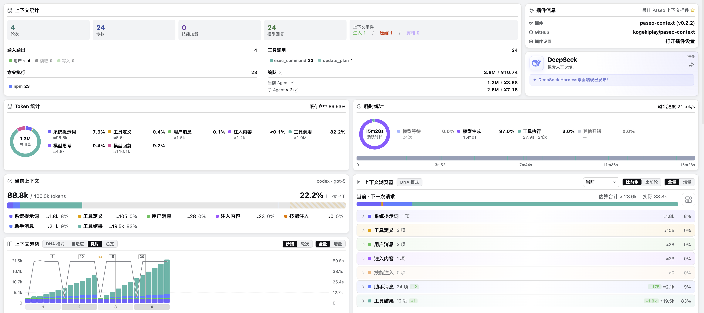

# Paseo Context

[简体中文](README.md)

Context insights for Paseo, forked from [bowenliang123/dsh-context](https://github.com/bowenliang123/dsh-context). The plugin bundles the current upstream React components, styles, charts, context browser and eight translations, connected to Paseo data through host adapters.

It keeps the upstream multicolor palette and light/dark styles. The interface is reused from source, rather than reconstructed from screenshots.

The following screenshots show the running plugin with generated sample records:




## Install

Requires Paseo **0.16.0+** and Node.js 22+ on the daemon machine. The original interactive interface runs in Desktop, web and native iOS/iPadOS using Paseo's bundled WebView. The iPad client has completed a live rendering handshake. Android uses a separate message transport and remains experimental. Narrow layouts use the upstream responsive styles.

After enabling plugins in Paseo:

```sh
paseo plugin install git:kogekiplay/paseo-context
```

The same source can be entered in Settings → Plugins. Git installation builds the original interface from source. A remote installation reads sessions on the selected remote daemon.

For local development:

```sh
git clone https://github.com/kogekiplay/paseo-context.git
cd paseo-context
npm ci --ignore-scripts
npm run build
paseo plugin install "$PWD"
```

After editing, build again and run `paseo plugin reload paseo-context`.

## Features

- Context panels in workspace tabs and Explorer: composition, usage, timing, trends, steps/turns, full/incremental views and comparison against the previous step or turn.
- Original context browser: DNA, grouped rows, treemap, filtering, content expansion, system prompts and captured tool schemas.
- File activity and commands: reads, writes, searches, counts, line changes, failures, duration and background process state.
- Fleet: agent network, communication timeline, delegations, captured tasks/dependencies, prompts and replies.
- Context Insights: session usage, date ranges, heatmap, skill/tool/program rankings, search, archive and directory filters.
- Context, Fleet and Statistics workspace tabs are added automatically when an agent conversation is opened. Context becomes active and the conversation tab remains available. The Context composer button is removed. All three entries are available in the workspace tab bar's **+** menu.
- Statistics shows the selected agent's turns, steps, usage, estimated cost, original token/timing charts and paginated request details.
- `/context`, `/context fleet` and `/context stats` open the corresponding tabs. `/context insights` opens cross-session insights, and `/context modal` opens the modal.
- Original preferences for placement, fleet/insights visibility, date range, granularity, comparison baseline and sorting.

These native Paseo workspace tabs sit alongside agents, terminals and files. Each workspace has one of each; an agent selector shares the selection across the three panels and persists it in tab state. Each agent initializes its tabs once per client plugin lifetime, so ordinary session updates do not reopen manually closed tabs. Paseo exposes no equivalent to DSH's permanent tabs inside a conversation.

Sidebar-only placement opens Context in Explorer and automatically adds only Fleet and Statistics. Hidden placement disables automatic tab creation. Disabling Fleet removes its menu entry and stops adding it automatically. Existing agent-specific tabs from earlier versions remain supported.

Prompt prefix/suffix settings apply to **new agents' systemPrompt**. They do not rewrite existing agents or dynamically modify each provider request; Paseo has no equivalent dynamic system-section hook.

## Data and limits

The daemon reads complete local Codex rollout and Claude Code JSONL records when available, preserving historical billed requests, compaction replacement history, rollbacks and tool results. Other providers and sessions without native logs use paginated Paseo timeline fallback.

Actual usage means provider-reported usage. Colored composition uses the upstream fixed-density text estimate. Unlogged system prompts, schemas, encrypted reasoning, server injections and internal timing phases cannot be reconstructed. Empty values are not evidence of zero usage. Timeline fallback exposes less information.

Costs use public model pricing and remain unknown for unmatched models. Timing comes from observable request/tool intervals, distinguishing aggregate parallel tool work from elapsed busy time. Speed uses output samples with matching available timing. These are estimates, not account bills or complete provider traces.

Fleet relationships and task/communication fields reflect captured Paseo/native records. Unavailable provider team internals are left unavailable.

DSH/Cordis runtime integration, account wallets, resource protocols, file manager and built-in host pages are removed. File operations use Paseo Context previews with the upstream rich-text viewer: current text files up to 2 MiB and image files up to 20 MiB. Images retained in native records can be viewed directly. Missing attachments and unsupported binary formats are reported as unavailable.

## Data access

Session text travels from the selected Paseo host to your own client using plugin RPC. It is not sent to third-party analytics. The UI is bundled locally in an isolated frame and does not load remote scripts.

Public metadata requests fetch model pricing from `models.dev`, this fork's latest GitHub release and upstream recommendation card data. Recommendation icons can load from their HTTPS image sources. Those requests contain no session text. HTTPS image URLs already referenced by a session are fetched by the client only when that image preview is expanded.

If the daemon explicitly has `DEEPSEEK_API_KEY`, the balance capsule uses only the official `https://api.deepseek.com/user/balance` endpoint. Otherwise it is hidden. The key is not sent to the client or other sites. No DSH settings or credentials are read.

Plugins run as trusted local code with the daemon user's filesystem access. Configured prompt prefixes/suffixes are sent to the selected model provider as part of new agents' system prompts.

## Development and upstream

```sh
npm run check
npm run build
```

`src/client` and `src/shared` preserve the upstream layout. `web/` builds the original DOM UI and its bridge; `client/` contains the Paseo wrapper; `server/` contains native log/SDK adapters; `shared/core/` contains reusable upstream algorithms for the daemon.

The public GitHub fork retains upstream history. Baseline: **`9e221195ac7c02cff9a21311dda6d61f50cf50d3`**, immediately after v0.85.1. See [docs/UPSTREAM.md](docs/UPSTREAM.md) for merging updates.

## License

Apache-2.0. See [LICENSE](LICENSE), [NOTICE](NOTICE) and [THIRD_PARTY_NOTICES.md](THIRD_PARTY_NOTICES.md). Static upstream primitives/theme/store modules in `web/vendor/` retain their MIT notices and do not require a DSH or Cordis host.
